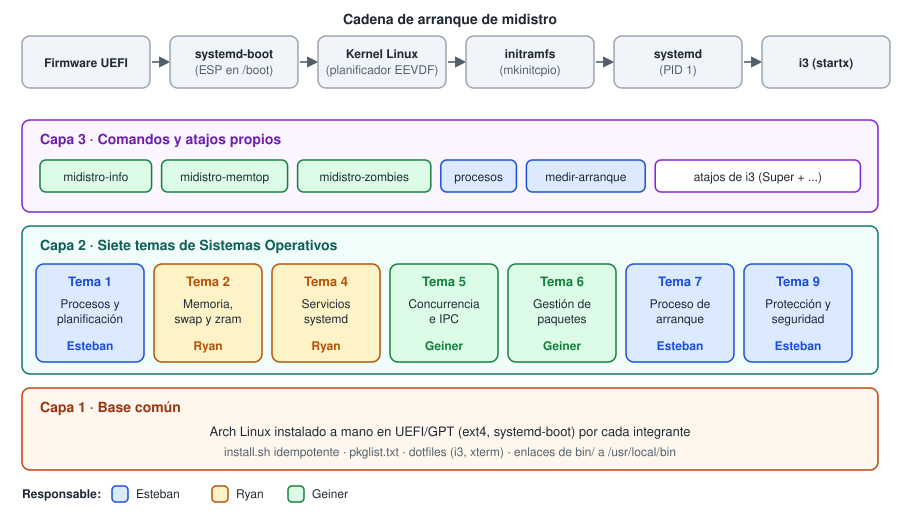
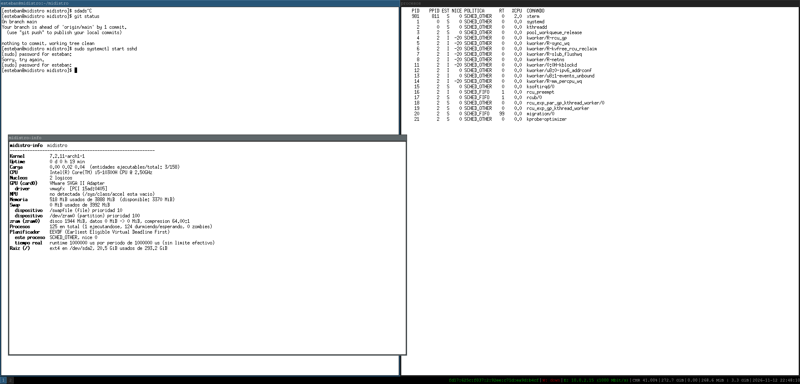

# midistro

Distribución de Linux propia, basada en Arch Linux e instalada a mano.
II Proyecto Programado de IC-6600 Principios de Sistemas Operativos, II semestre 2026 (Alternativa A).

Integrantes: Esteban McKenzie, Ryan Vargas y Geiner Barrantes.





## Qué es

midistro es una instalación de Arch Linux con gestor de ventanas **i3**, armada en tres capas:

1. **Capa 1, base común.** Arch instalado a mano en UEFI/GPT (ext4, `systemd-boot`) por cada integrante, y un script `install.sh` idempotente que, sobre una instalación base limpia, instala los paquetes (`pkglist.txt`), enlaza los dotfiles, instala los comandos propios y habilita los servicios.
2. **Capa 2, temas de Sistemas Operativos.** Siete temas, cada uno con una ficha de evidencia con datos medidos e interpretación del concepto.
3. **Capa 3, comandos y atajos propios.** Un comando que lee `/proc` y `/sys`, comandos libres de cada integrante y atajos de teclado en i3, con su cheatsheet.

## Requisitos

| Recurso | Mínimo |
| --- | --- |
| Máquina virtual | VirtualBox con **EFI activado** (Configuración, Sistema, «Habilitar EFI») |
| Memoria | 4 GB de RAM (las pruebas de los Temas 1, 7 y 9 se hicieron con 3888 MiB; las del Tema 2 con 1915 MiB visibles, a propósito, para forzar presión de memoria) |
| Procesadores | 2 núcleos virtuales |
| Disco | 20 GB o más |
| Red | Adaptador 1 en NAT, con salida a internet. Un segundo adaptador *host-only* es opcional, solo para el escaneo con `nmap` del Tema 9 |
| Instalador | ISO de Arch Linux |

## Instalación

**Paso 1. Instalar Arch a mano.** Se hace una sola vez, siguiendo la bitácora paso a paso en [`docs/instalacion.md`](docs/instalacion.md). Cubre el particionado, `pacstrap`, `fstab`, el chroot, el cargador de arranque y el primer inicio de sesión, con el porqué de cada comando.

**Paso 2. Aplicar el bootstrap.** Ya en el sistema instalado y con `git` disponible (`sudo pacman -S git` si hace falta):

```bash
git clone https://github.com/EstebanMckenzie/midistro.git
cd midistro
mkdir -p logs
./install.sh 2>&1 | tee logs/install-<su-nombre>.log
startx
```

`install.sh` se ejecuta como usuario normal (usa `sudo` cuando lo necesita) y se puede correr varias veces sin romper nada: la segunda corrida no descarga nada (`there is nothing to do`). La prueba final se hizo sobre una instalación base limpia, sin escritorio: la primera corrida instala 154 paquetes y la segunda no descarga ninguno ([`install-esteban-final.log`](logs/install-esteban-final.log) y [`install-esteban-final-2da.log`](logs/install-esteban-final-2da.log)). Después se comprobó que quedan activos el swap en zram, el swapfile y el timer del Tema 4 ([`verificacion-final.txt`](logs/verificacion-final.txt)). Los logs de cada integrante están en [`logs/`](logs/).

**Paso 3 (opcional). Seguridad del Tema 9.** `install.sh` no lo ejecuta a propósito, porque activa un firewall que niega todo lo que entra y cierra el acceso por SSH con contraseña. Antes de aplicarlo hay que leer [`docs/tema-09-seguridad.md`](docs/tema-09-seguridad.md) y tener instalada una llave SSH en la VM. Después:

```bash
sudo security/aplicar.sh
sudo security/probar-negativas.sh
```

## Mapa del repositorio

| Ruta | Contenido |
| --- | --- |
| `install.sh`, `pkglist.txt` | Bootstrap idempotente y lista de paquetes |
| `dotfiles/` | `xinitrc`, `Xresources` y la configuración de i3 (incluye todos los atajos) |
| `bin/` | Comandos propios (se enlazan a `/usr/local/bin` con `install.sh`) |
| `boot/` | Entrada de rescate de `systemd-boot` (Tema 7) |
| `security/` | `nftables`, `sudoers`, `sshd_config` y ACL, con su script de aplicación y de pruebas (Tema 9) |
| `pacman/` | Hook de ALPM y `PKGBUILD` (Tema 6) |
| `src/` | Mini-programa de concurrencia e IPC (Tema 5) |
| `systemd/` | Configuración de zram (Tema 2) y unit file y timer del servicio de estado (Tema 4) |
| `scripts/` | Scripts que reproducen la evidencia de los Temas 2, 4, 5 y 6, y el que crea el swapfile |
| `logs/` | Logs de ejecución de `install.sh` |
| `docs/` | Bitácora de instalación, matriz de responsabilidades, bitácora de IA, cheatsheet, documentación de comandos y las fichas de evidencia |
| `docs/evidencia/` | Salidas guardadas: una carpeta por integrante (`esteban/`, `geiner/`, `ryan/`) y una por tema para los Temas 2, 4, 5 y 6 |

## Capa 2: temas de Sistemas Operativos

| Tema | Responsable | Ficha | Resultado principal |
| --- | --- | --- | --- |
| 1 · Procesos y planificación | Esteban | [`tema-01-procesos.md`](docs/tema-01-procesos.md) | Con `nice`, el reparto de CPU coincide con la tabla de pesos del kernel con menos de 0.1 puntos de diferencia (nice 0 contra 5: 75.4 % / 24.6 %). Con `SCHED_FIFO`, el proceso normal queda con unos 5 % |
| 2 · Memoria, swap y zram | Ryan | [`tema-02-memoria.md`](docs/tema-02-memoria.md) | Con 1.68 GB de carga en una VM de 2 GiB, el rendimiento de `stress-ng` es el mismo (45.63 contra 45.56 ops/s), pero con zram el swapfile termina unos 733 MiB menos ocupado y zram comprime unas 3.8 veces. No se demuestra una mejora de velocidad |
| 4 · Servicios systemd | Ryan | [`tema-04-servicios.md`](docs/tema-04-servicios.md) | Servicio con timer y límites de cgroup: con `CPUQuota=20%` se midió entre 18.2 % y 19.9 % de un núcleo, y un fallo provocado reinicia el servicio (`NRestarts=1`) |
| 5 · Concurrencia e IPC | Geiner | [`tema-05-concurrencia-ipc.md`](docs/tema-05-concurrencia-ipc.md) | Mini-programa de IPC en C (`src/primes_ipc.c`) con evidencia de `strace` |
| 6 · Gestión de paquetes | Geiner | [`tema-06-gestion-paquetes.md`](docs/tema-06-gestion-paquetes.md) | Hook de ALPM propio y `PKGBUILD` de `midistro-zombies` |
| 7 · Proceso de arranque | Esteban | [`tema-07-arranque.md`](docs/tema-07-arranque.md) | En modo rescate corren 4 servicios y 12 targets, contra 10 y 21 en modo normal. La mejora medida del arranque (6.794 s a 5.219 s) no se puede atribuir a `sshd` |
| 9 · Protección y seguridad | Esteban | [`tema-09-seguridad.md`](docs/tema-09-seguridad.md) | Con el firewall, `nmap` desde otra máquina pasa de 2 puertos abiertos a solo el 22 |

## Capa 3: comandos y atajos

| Comando | Autor | Interfaz del sistema que usa | Documentación |
| --- | --- | --- | --- |
| `midistro-info` (obligatorio) | Geiner | `/proc` y `/sys` | [`comando-midistro-info.md`](docs/comando-midistro-info.md) |
| `midistro-memtop` | Geiner | `/proc/[pid]/status`, `/proc/meminfo` | [`comando-midistro-memtop.md`](docs/comando-midistro-memtop.md) |
| `midistro-zombies` | Geiner | `/proc` | [`tema-06-gestion-paquetes.md`](docs/tema-06-gestion-paquetes.md) |
| `procesos` | Esteban | `/proc/[pid]/stat` y llamadas de planificación | [`comando-procesos.md`](docs/comando-procesos.md) |
| `medir-arranque` | Esteban | `systemd` (`systemd-analyze`) | [`comando-medir-arranque.md`](docs/comando-medir-arranque.md) |
| `midistro-presion` | Ryan | `/proc/pressure/*` y `/proc/vmstat` | [`comando-midistro-presion.md`](docs/comando-midistro-presion.md) |
| `midistro-cgroup` | Ryan | `systemctl show` y cgroup v2 (`cpu.max`, `cpu.stat`, `memory.current`) | [`comando-midistro-cgroup.md`](docs/comando-midistro-cgroup.md) |

Atajos de i3 (`Super` es la tecla Windows): `Super+Enter` abre una terminal, `Super+W` cierra la ventana, `Super+D` abre el lanzador y `Super+1` a `Super+9` cambian de espacio de trabajo. Cada integrante tiene además 3 atajos libres. La lista completa y quién diseñó cada uno está en [`docs/cheatsheet.md`](docs/cheatsheet.md).

## Equipo, responsabilidades y uso de IA

- Reparto de temas y componentes: [`docs/responsabilidades.md`](docs/responsabilidades.md).
- Uso de IA (Claude, de Anthropic), con lo que se validó, se corrigió o se descartó, y los errores de la IA que se detectaron: [`docs/bitacora_ia.md`](docs/bitacora_ia.md).
